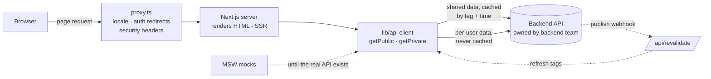

# Frontend starter — architecture & how to use it

A one-page overview for the team and for leads. Rules live in `CLAUDE.md`; the reasoning behind them in `docs/PROJECT-SETUP.md`.

## What it is and why

`nextjs-starter` is the team template for every new frontend project: **a Next.js app that consumes someone else's backend API** (.NET, Laravel, WordPress, Drupal or custom).

Every project starts with the same stack, folder structure, rendering approach and quality rules — and Claude Code reads those rules from `CLAUDE.md` in every session, so AI-assisted work follows them too. The benefits:

- **Consistency** — any developer can move between projects and find the same structure.
- **Fewer repeat mistakes** — lessons from past projects (caching bugs, RTL, Arabic fonts, Next.js issues) are built into the rules and lint.
- **Quality from day one** — accessibility (WCAG 2.2 AA, Mada where required), performance and SEO are part of each PR, not a pre-launch scramble.
- **Faster start** — `/scaffold` sets up a new project in one session instead of days.

## Architecture



- **This repo is the frontend only.** The backend owns data, auth and business rules; we build against its contract.
- **The Next.js server talks to the API**, not the browser. Pages are server-rendered (good SEO, fast first load).
- **Two ways to fetch, nothing else:**
  - `getPublic` — data that's the same for every visitor (content, menus). Cached, so 1,000 visitors ≈ 1 API call.
  - `getPrivate` — per-user data. Never cached, so one user's data can't leak to another.
- **Content refresh:** when the backend publishes, it calls a webhook and only the affected pages refresh — no redeploy. A time limit is the fallback.
- **Before the API exists**, MSW mocks stand in at the network level; flipping one env flag switches to the real API, and Zod validation reports anywhere reality differs from the mock.

### Stack

| Area | Choice |
|---|---|
| Framework | Next.js 16 (App Router), React 19, TypeScript strict, pnpm |
| Styling | Tailwind CSS v4, design tokens from Figma in `styles/tokens.css` |
| Languages | next-intl, English + Arabic with full RTL |
| Data | Typed API client, types generated from the backend spec, Zod validation |
| Forms | React Hook Form + Zod |
| Testing | Vitest, Playwright + axe (accessibility), Storybook |

### Quality targets

| Area | Target |
|---|---|
| Accessibility | WCAG 2.2 AA; Mada certification on Qatar government projects |
| Performance (p75, mid-range mobile) | LCP < 2.5s · INP < 200ms · CLS < 0.1 · TTFB < 800ms |
| Security | Server-side checks on every write, no secrets in the browser, security headers, no high / critical vulnerable packages |
| Languages | Every page correct in every language, including Arabic RTL, from 320 px up |

How each is checked — automatically or by a person — is in [What's automated and what isn't](#whats-automated-and-what-isnt).

## Security

The backend team owns login and permissions, but our Next.js server is exposed to the internet too. Every form and Server Action is a public endpoint that anyone can call directly, skipping our pages. So the rule is: **every check that matters happens on the server.**

What the template already does:

- The browser never talks to the backend directly — only our server does.
- CMS HTML is sanitised before it's shown, and lint blocks raw HTML injection.
- Personal data is never cached, so it can't leak between users.
- No libraries loaded from outside CDNs.

What we check on every PR that touches it (full list and how to test each: `docs/PROJECT-SETUP.md` §11):

| Area | Check | Quick test |
|---|---|---|
| **Forms** | Input validated on the server, not just in the browser | Resend the request with junk data using *Copy as cURL* — must be rejected |
| **Forms** | Each action checks who's logged in and what they may do | Resend it logged out, or as another user — must be refused |
| **Forms** | Public forms have spam / brute-force protection | Submit 20 times fast — should be blocked |
| **Forms** | Errors are generic; login errors don't reveal which emails exist | Force an error; try a real and a fake email |
| **Uploads** | File type and size checked on the server | Upload an `.html` renamed to `.jpg` — must be rejected |
| **Webhook** | Secret in a header, constant-time check, POST only, size limit, rate limit | `curl` with a wrong secret → 401; GET → 405; 31 quick calls → 429 |
| **Captcha** (if needed) | No visual puzzle (reCAPTCHA v3 / Turnstile); token verified on the server | Submit with no token or a fake token — must be refused |
| **Login** | Session in a secure httpOnly cookie, never in `localStorage` | DevTools → Application → Cookies / Local Storage |
| **Login** | User A can't open user B's data by changing an ID | Change the ID in the URL — must be refused |
| **Login** | Login redirect only goes to our own site | Try `?next=https://evil.example` |
| **Pages** | Security headers set (CSP, HSTS…) | Scan staging at securityheaders.com |
| **Pages** | CMS content and search terms can't run scripts | Enter `<script>alert(1)</script>` — shows as text |
| **Code** | No secrets in the browser; no vulnerable packages | Search the JS in DevTools; `pnpm audit --prod` |

Before launch: an OWASP ZAP scan on staging, a penetration test, and — on Qatar government projects — NIA compliance if the contract requires it.

## What's automated and what isn't

Three lists: what machines check and how, what a person has to check and how, and what's planned but not automated yet.

### 1. Automated

**When** = where it runs: ✏️ while editing (Claude's edit hook) · 💾 on every commit (Husky pre-commit) · 🔀 on every pull request (`azure-pipelines.pr.yml`).

| Check | How — tool and file | When | Fails if |
|---|---|:-:|---|
| Project rules: no `fetch` in components, no mock imports, `next/image` only, no CDN libraries, no hardcoded container widths | ESLint — `eslint.project-rules.mjs` | ✏️ 💾 🔀 | A rule is broken |
| Arabic / RTL: logical classes only | ESLint — `eslint.project-rules.mjs` | ✏️ 💾 🔀 | `pl-`, `mr-`, `left-`, `text-right`, `rounded-l`… appear |
| Design tokens: no raw values | ESLint — `eslint.project-rules.mjs` | ✏️ 💾 🔀 | Hex / rgb / px / rem inside Tailwind brackets (`p-[13px]`) |
| No hardcoded UI text | ESLint `react/jsx-no-literals` | ✏️ 💾 🔀 | Text written directly in JSX instead of `messages/*.json` |
| Accessibility lint | ESLint `jsx-a11y` (strict) + no `outline-none` | ✏️ 💾 🔀 | Missing alt, bad ARIA, click on a `<div>`, focus outline removed |
| Server code stays on the server | ESLint — `import "server-only"` required in `lib/api`, `lib/auth`, `lib/security` | ✏️ 💾 🔀 | A server module lacks it; the build fails if one is imported by client code |
| Formatting | Prettier — `lint-staged.config.mjs` | 💾 | — (fixes it automatically) |
| Leaked secrets | secretlint — `.secretlintrc.json` | 💾 | An API key, token, private key or password is staged |
| No AI attribution in commits | `.husky/commit-msg` | 💾 | Message contains `Co-Authored-By: Claude` or "Generated with Claude Code" |
| Translations complete | Vitest — `lib/i18n/messages.test.ts` | 💾 🔀 | A key is missing from a language, or a value is empty |
| Every UI component has a Storybook story | Vitest — `tests/unit/stories.test.ts` | 💾 🔀 | A `components/ui` file has no `.stories.tsx` (and no `// no-story:` reason) |
| Colour contrast | Vitest — `styles/contrast.test.ts` | 💾 🔀 | A token pair is below 4.5:1 (text) or 3:1 (UI, focus ring) |
| Types, including translation keys | `tsc` — `pnpm typecheck` | 🔀 | Type error, or a `t()` key that doesn't exist |
| Vulnerable packages | `pnpm audit --prod --audit-level=high` | 🔀 | A high or critical advisory |
| Layout on every screen size | Playwright — `tests/e2e/layout.spec.ts` | 🔀 | Sideways scrolling in any language at 320 / 768 / 1280 / 1536 / 1920 px — 1280 and 1536 are laptops at 150% and 125% display scaling (lists the elements) |
| Accessibility in a real browser | Playwright + axe — `tests/e2e/layout.spec.ts` | 🔀 | Any WCAG 2.2 AA violation, any language, at all five widths |
| Valid HTML | Playwright + html-validate — `tests/e2e/markup.spec.ts`, rules in `.htmlvalidate.json` | 🔀 | Invalid nesting, duplicate IDs, unclosed tags on any template |
| Page basics | Playwright — `tests/e2e/smoke.spec.ts` (created by `/scaffold`) | 🔀 | Wrong `lang` / `dir`, missing security headers, first Tab doesn't reach a visible skip link |
| Webhook refuses bad calls | Vitest — `tests/unit/revalidate.test.ts` | 💾 🔀 | `/api/revalidate` accepts a wrong / missing secret, non-JSON, an oversized body, bad tags, or more than 30 calls a minute |
| Secret check and rate limiter work | Vitest — `tests/unit/security.test.ts` | 💾 🔀 | Constant-time secret check accepts a near-miss or an unset secret; rate limiter lets too many through |
| Forms refuse bad requests | A test per Server Action / route handler (`CLAUDE.md` §6) | 🔀 | The action accepts a logged-out or invalid request |
| Visual changes (optional) | Playwright screenshots — `pnpm test:visual` | on demand | A page looks different from its saved baseline |

**Conditions:**
- Nothing runs until `/scaffold` has installed the tools.
- 🔀 only **blocks a merge** once the project adds `azure-pipelines.pr.yml` as a required build validation on its main branch in Azure DevOps.
- Each new page template has to be added to `PAGES` in `tests/e2e/pages.ts` to get layout, axe and HTML checks.

### 2. Manual — a person has to do these

Each is a checkbox in the PR template (`.azuredevops/pull_request_template.md`).

| Check | Why a machine can't | How to do it | When |
|---|---|---|---|
| Page accessibility audit | Combines automated checks with keyboard checks and a fixed triage | Ask Claude to *"audit /news for accessibility"* — the `a11y-audit` skill runs the script in every locale at 320 px and desktop, walks the keyboard checks, fixes code bugs, records token issues for the designer | Each new page, and before launch |
| Keyboard pass | Tools can't judge whether the order and behaviour make sense | Tab / Shift+Tab / Enter / Esc through everything the change touches; focus always visible | Every PR with interactive UI |
| Screen reader | Tools can't judge whether it's understandable | VoiceOver (Mac) or NVDA (Windows), in English and Arabic | First instance of each interactive pattern |
| Match the design | Only a person can judge against Figma | Compare side by side at 320 px, tablet and desktop, in every language | Every UI PR |
| Security the tests don't cover | Needs knowledge of who owns which data | Change an ID in the URL to another user's; try `?next=https://evil.example`; upload wrong file types and sizes (`docs/PROJECT-SETUP.md` §11) | PRs touching login, forms or uploads |
| Speed | Lab scores on shared agents are noisy | Lighthouse mobile (throttled) before and after; numbers in the PR table | Speed-related PRs |
| Translation quality | Tests check a text exists, not that it's right | Native reviewer for each language | New or changed text |
| Mada readiness | Certification is Mada Center's own audit | `mada-audit` skill for readiness: every page plus site-level items, report in `docs/mada-readiness.md` | Before booking the Mada audit |
| Launch checks | Contractual, done by specialists | Penetration test; Mada audit and NIA compliance where the contract requires them; OWASP ZAP scan of staging | Before launch |

### 3. Not automated yet

| Item | Plan |
|---|---|
| Lighthouse speed budgets | Add to the PR pipeline as warnings first, failing only on large regressions |
| API types match the backend | `pnpm types:check` exists; each project adds it to the pipeline once there's a spec URL |
| Dependency update alerts | Renovate, since Dependabot isn't built into Azure DevOps |

## Skills — repeatable checks Claude runs for you

| Skill | Ask Claude, for example | What it does |
|---|---|---|
| `a11y-audit` | *"Check /news for accessibility"* | One page, every locale, 320 px + desktop: structure, skip link, axe (WCAG 2.2 AA), list markup, keyboard focus walk, manual keyboard checks; fixes code bugs, records token issues for the designer |
| `mada-audit` | *"Are we ready for the Mada audit?"* | Every page in the sitemap through `a11y-audit`, plus site-level items: accessibility statement in each language, language switch, captions, iframe titles, documents to check; writes `docs/mada-readiness.md`. A readiness check — not certification |
| `w3c-validate` | *"Validate the HTML of the home page"* | W3C markup validity with html-validate, locally (same rules as CI); finds whether the cause is a component or CMS rich text and fixes it there |
| `seo-audit` | *"Check SEO on these pages"* | Title, description, canonical, hreflang + x-default, Open Graph / Twitter, JSON-LD, robots, sitemap, duplicates — fixed through `generateMetadata` and `lib/seo` |
| `heading-hierarchy` | *"Fix the heading order"* | Page outline per locale (one h1, no skipped levels, no empty headings) and a scan for hardcoded levels in reusable components |
| `images-webp` | *"Convert the images to WebP"* | Dry run, then converts PNG/JPEG in `public/assets`, updates code references, checks pages; deletes originals only with your OK. Skips SVG, GIF, icons and social-share images |

Each skill has a script next to its `SKILL.md`, so the automated part runs the same way every time. Claude picks the skill by itself from what you ask — no command to remember. All of them run against a production build (`NEXT_PUBLIC_USE_MOCKS=true pnpm build && pnpm start --port 3300`) and never commit without asking.

## How to start a new project

**Needs:** Node 24 LTS, pnpm 12, Claude Code, access to the private `nextjs-starter` repo and an SSH key on GitHub. Full commands and a troubleshooting table: [README → Starting a new project](../README.md#starting-a-new-project).

1. **Create the project from the template** — name it lowercase with hyphens, no spaces (`unified-education-record`):
   - GitHub: **Use this template → Create a new repository**, then clone it.
   - Azure DevOps: **Repos → Import repository** with this repo's GitHub URL, then clone.
   - Or a local copy over SSH (plain `npx degit owner/repo` can't see a private repo):
     ```bash
     npx degit git@github.com:manikantanapplab/nextjs-starter my-project --mode=git
     ```
2. **Open a fresh Claude Code session inside the project folder** — desktop app: choose the folder; terminal: `cd my-project && claude`. `/scaffold` is a project command, so it isn't found from any other folder.
3. **Type `/scaffold`** and answer the 15 questions — project name, backend and owner, spec URL, audience, login, languages, Mada, redirects, rich text, webhooks, monitoring, form handling, design source (Figma, existing HTML or screenshots).
4. **Review the plan and approve.** Claude creates the app, installs everything and runs every check. Approve the lint hook when asked. It asks before committing.
5. **Once per project in Azure DevOps:** make `azure-pipelines.pr.yml` a required Build validation on `main`.
6. **Fill the plan:** pages in the `CLAUDE.md` §2 route table and `docs/PROJECT-SETUP.md` §16, real design tokens, the spec URL — then start building.

## Day-to-day work

- **Just ask Claude in plain language** — "build the home page from this Figma frame", "add a `/news/[slug]` page". It follows `CLAUDE.md` and fixes its own lint errors.
- **Build order:** design tokens → shared UI components → one page end-to-end → the rest.
- **Before a PR:** lint, typecheck and tests pass; checked in every language at mobile, tablet and desktop; keyboard pass on anything interactive; any form or action tested directly while logged out and with bad data. Optionally run `/code-review`.
- **Found a bug's root cause?** Add it to `docs/known-issues.md` and a one-line rule to `CLAUDE.md` §9.
- **Improvement that helps every project?** Put it in this template repo, so the next project starts with it.

## Open decisions — need sign-off

Decided per project, or once for the team:

- Supported browser matrix
- Hosting target (Node server / container / platform) and who owns the pipeline
- Auth method and session storage, for projects with login
- Preview / draft-content workflow
- Site search scope
- Numerals and calendar per locale (Western vs Eastern Arabic, Gregorian vs Hijri)
- Who reviews each language's content
- Security requirements in the contract: pen test (who and when), Qatar NIA compliance, spam protection for public forms

## Where to find what

| File | Read it when | What's in it |
|---|---|---|
| `docs/ARCHITECTURE.md` | First — you're here | The overview: architecture, quality gates, security, how to start |
| `README.md` | Starting a new project | Prerequisites and the exact setup commands |
| `docs/PROJECT-SETUP.md` | **Onboarding, then as a reference while building** — read §1–3 first | The full guide and the *why* behind every rule (sections below) |
| `CLAUDE.md` | Checking a rule | The rules Claude and the team follow — short, no explanations. Wins if it differs from the setup guide |
| `docs/known-issues.md` | Something breaks strangely | Past incidents, their cause and the workaround |

**`docs/PROJECT-SETUP.md` at a glance:**

| Section | Covers |
|---|---|
| §1 | Stack decisions and why each was chosen |
| §2–3 | Architecture, rendering and caching per page type |
| §4–5 | Connecting each backend type (.NET, Laravel, WordPress, Drupal), the API client, mocks, CMS rich text |
| §6 | Design workflow: Figma and existing HTML → code |
| §7 | Arabic / RTL and translations |
| §8 | Accessibility and Mada |
| §9 | SEO and moving from an old site (redirects) |
| §10 | Performance budgets |
| §11 | Security — every check and how to test it |
| §12 | Environment variables and config |
| §13 | Scaffolding a new project manually |
| §14–15 | Milestone checklist and definition of done per page |
| §16 | Page inventory — the list of pages to build |
| §17 | Scripts and branch / PR workflow |
